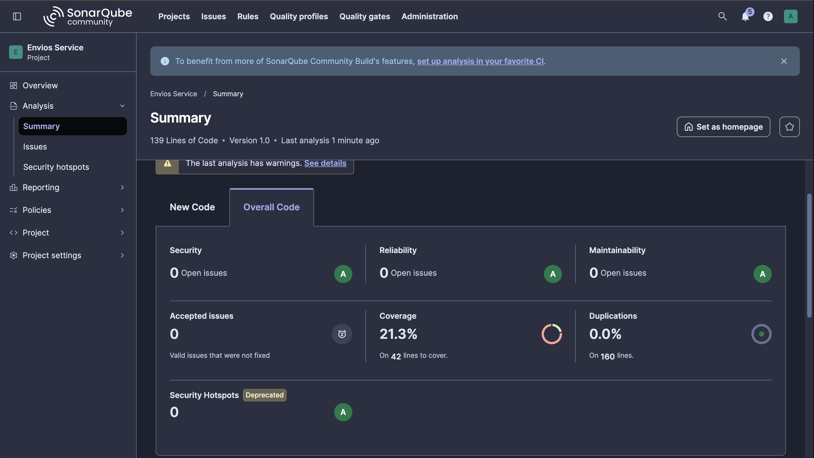
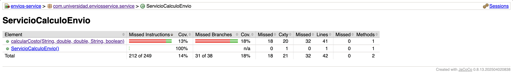
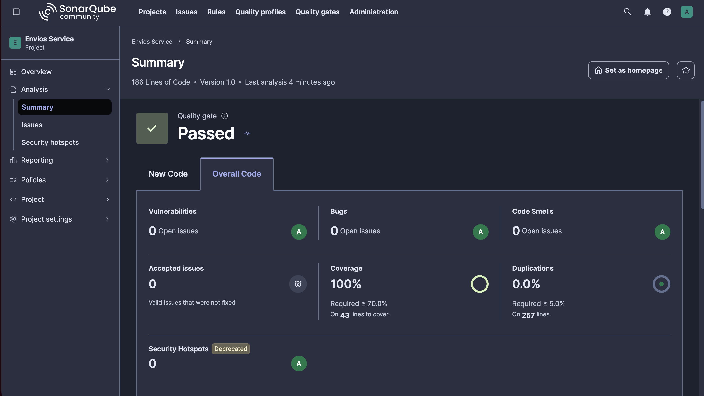
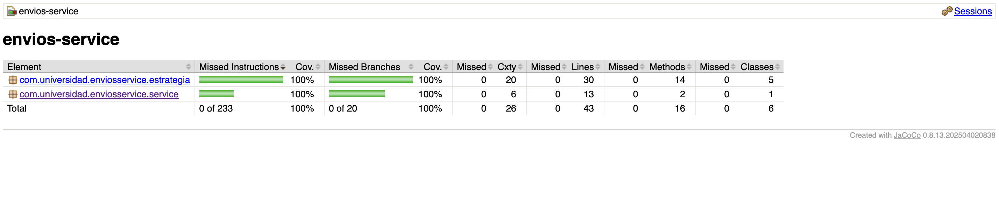
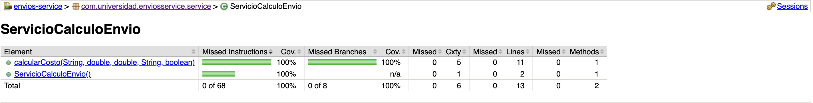
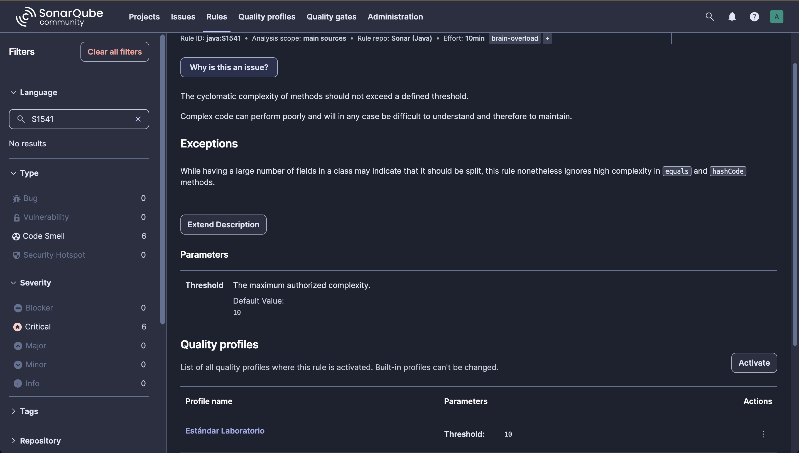
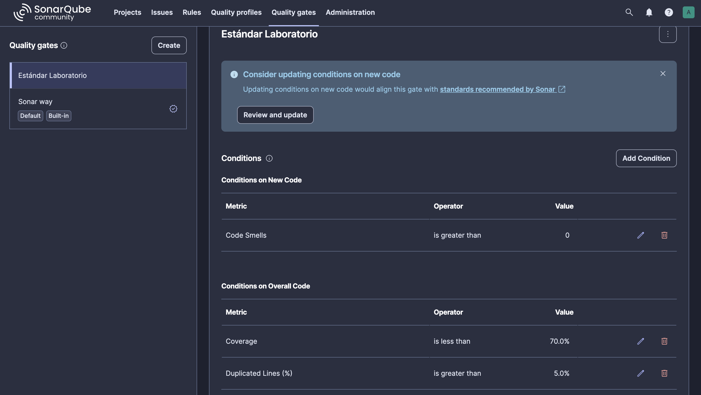

# Envios Service — Diagnóstico y Mejora Guiada por Métricas

**Post-contenido — Unidad 10 · Patrones de Diseño de Software**
Juan Sebastián Gamboa Cristancho · Universidad de Santander (UDES) · Cúcuta, 2026

Proyecto Maven plano (sin Spring Boot) que calcula el costo de un envío según el método de transporte, el peso, la distancia, la fragilidad y el tipo de cliente. En la **Parte 1** la clase `ServicioCalculoEnvio` concentraba toda la lógica en un único método, `calcularCosto()`, y una suite de dos pruebas; el diagnóstico se hizo con métricas reales de **SonarQube** y **JaCoCo**. En la **Parte 2** se aplicó el patrón **Strategy**, se agregaron pruebas sobre las ramas que el reporte mostró sin cubrir, se configuró el Quality Gate «Estándar Laboratorio» y se repitió el análisis para comparar con evidencia.

## Resultado en una línea

| Métrica | Antes (Parte 1) | Después (Parte 2) | Cambio |
|---------|-----------------|-------------------|--------|
| Complejidad ciclomática de `calcularCosto()` | **20** | **5** | **−75 %** |
| Cobertura de ramas de la lógica de envío | **18,4 %** (7/38) | **100 %** (20/20) | **+81,6 pp** |
| Code Smells | 0 *(regla de CC inactiva)* | 0 *(con S1541 activa en 10)* | — |
| Quality Gate «Estándar Laboratorio» | — | **Passed** | — |

## Estructura del proyecto

```
gamboa-post1-u10/
├── pom.xml                          ← Java 21, JUnit 5, JaCoCo (prepare-agent + report)
├── sonar-project.properties         ← configuración comentada del análisis
├── docs/                            ← capturas de SonarQube y JaCoCo (antes / después)
└── src/
    ├── main/java/com/universidad/enviosservice/
    │   ├── service/
    │   │   └── ServicioCalculoEnvio.java         ← orquestador (CC 5)
    │   └── estrategia/
    │       ├── EstrategiaEnvio.java              ← interfaz Strategy
    │       ├── TarifaPorPeso.java                ← tramos de peso compartidos (CC 3)
    │       ├── EnvioEstandarStrategy.java        ← CC 2
    │       ├── EnvioExpressStrategy.java         ← CC 2
    │       ├── EnvioOvernightStrategy.java       ← CC 2
    │       └── EnvioInternacionalStrategy.java   ← CC 2
    └── test/java/com/universidad/enviosservice/
        ├── service/ServicioCalculoEnvioTest.java ← 9 pruebas (2 de partida + 7)
        └── estrategia/                           ← 24 pruebas (5 clases)
```

## Cómo ejecutar el análisis

```bash
# 1. SonarQube local (Docker)
docker run -d --name sonarqube -p 9000:9000 -e SONAR_ES_BOOTSTRAP_CHECKS_DISABLE=true sonarqube:community

# 2. Compilar, probar, generar jacoco.xml y enviar el análisis
./mvnw clean verify sonar:sonar -Dsonar.token=<TOKEN_DEL_PROYECTO>

# 3. Reporte HTML de cobertura
open target/site/jacoco/index.html
```

> El token no se versiona: se pasa por línea de comandos. SonarScanner for Maven no lee `sonar-project.properties`, por eso sus propiedades están replicadas en el `<properties>` del `pom.xml`; el archivo se conserva comentado como documentación y para el SonarScanner CLI.

---

## Decisiones de diseño

### 1. Entorno de análisis: SonarQube local con Docker

Se usó **SonarQube Community Build 26.10** en Docker (`sonarqube:community`) en lugar de SonarCloud:

- **Control total de la configuración.** La Parte 2 exige crear un Quality Profile y un Quality Gate propios. El plan gratuito de SonarCloud no permite Quality Profiles ni Quality Gates personalizados; la instancia local los permite sin restricciones.
- **Sin dependencia de conectividad ni de límites del plan gratuito**, y sin exponer el código en un dashboard público.
- **Costo asumido:** consume recursos de la máquina (4 GB de memoria asignados a Docker Desktop) y el contenedor debe mantenerse en ejecución durante todo el laboratorio. La base de datos embebida basta para un laboratorio, no para producción.

### 2. Exclusiones del análisis: ninguna

`sonar.exclusions` queda sin valor. El proyecto no contiene clase de arranque (`Main`), DTOs, configuración ni código generado: todo `src/main/java` es lógica de negocio. Excluir algo solo mejoraría artificialmente el porcentaje y ocultaría justamente el código que se quiere medir. Las pruebas no necesitan exclusión porque `sonar.tests=src/test/java` ya las separa del cálculo de cobertura.

### 3. Métrica usada como señal principal: complejidad ciclomática por método

- **Coverage (18,4 % de ramas)** es el síntoma: indica que faltan pruebas, pero no por qué ni qué cambio de diseño las haría manejables.
- **Cognitive Complexity (32)** mide la dificultad de lectura y penaliza el anidamiento; es útil para priorizar legibilidad, pero no se traduce en caminos que probar ni tiene el umbral por método (10) que usan la guía y la regla S1541.
- **Cyclomatic Complexity (20)** cuenta los caminos independientes del método y explica directamente por qué dos pruebas cubren tan poco. Además es la métrica que el refactor promete reducir de forma medible y la que el Quality Profile controla por método.
- **El número de Code Smells (0)** quedó descartado: con el perfil por defecto `Sonar way core` la regla de complejidad por método no estaba activa, así que el dashboard mostraba Maintainability A con un método de CC 20.

En este proyecto las tres señales coinciden en `calcularCosto()` porque es el único método con lógica: su baja cobertura es consecuencia directa de su complejidad.

### 4. Patrón elegido: Strategy

Análisis de la naturaleza de los condicionales de `calcularCosto()` con la tabla del Paso 7:

| Pregunta | Respuesta en el método | Conclusión |
|----------|------------------------|------------|
| ¿Guarda estado entre llamadas que condicione su comportamiento futuro? | No. La clase no tiene atributos mutables y cada llamada depende solo de sus cinco parámetros; un envío no transita de `ESTANDAR` a `EXPRESS`. | Descarta **State** |
| ¿Existe una secuencia de responsables donde el orden importa y varios podrían aplicar? | No. Los cuatro métodos de envío son excluyentes: exactamente uno aplica y el orden del `if/else if` es irrelevante. | Descarta **Chain of Responsibility** |
| ¿Cada rama calcula el mismo tipo de resultado con una fórmula propia, elegida una sola vez por un valor de entrada? | Sí. Cada rama de `metodoEnvio` produce un costo con su fórmula y sus reglas. | **Strategy** |

**Qué se movió a las estrategias.** La fórmula de cada método de envío y su regla propia: el recargo por distancia de `ESTANDAR` (> 500 km), `EXPRESS` (> 500 km y factor de prioridad 1,3) e `INTERNACIONAL` (> 5000 km), y la restricción de `OVERNIGHT` (excepción sobre 300 km). La cadena de `equals()` se reemplazó por un `Map<String, EstrategiaEnvio>`.

**Qué se quedó en el orquestador, y por qué.** El recargo por fragilidad y los descuentos `PREMIUM` y `CORPORATIVO` son reglas transversales: se aplican igual a los cuatro métodos de envío, después de calcular el costo base. Moverlos a cada estrategia duplicaría esa lógica cuatro veces. Por eso `calcularCosto()` no queda en CC 1 sino en **5** (1 + estrategia nula + fragilidad + PREMIUM + CORPORATIVO), dentro del rango «Moderada» de la Tabla 3.2.

**Ajuste respecto al ejemplo de la guía: `TarifaPorPeso`.** Los cuatro métodos de envío comparten exactamente los mismos tramos de peso (hasta 5 kg, de 5 a 20 kg y más de 20 kg) y solo difieren en las tarifas. Copiar el `if/else` de tramos en cada estrategia habría repetido el mismo bloque cuatro veces (duplicación evitable). La fórmula vive una sola vez en el record `TarifaPorPeso` y cada estrategia declara sus valores; los números sueltos se reemplazaron por constantes con nombre.

```java
public double calcularCosto(String metodoEnvio, double pesoKg, double distanciaKm,
                            String tipoCliente, boolean esFragil) {
    EstrategiaEnvio estrategia = estrategias.get(metodoEnvio);
    if (estrategia == null) {
        throw new IllegalArgumentException("Metodo de envio no soportado: " + metodoEnvio);
    }
    double costo = estrategia.calcular(pesoKg, distanciaKm);
    if (esFragil) {
        costo = costo + costo * RECARGO_FRAGIL;
    }
    if (tipoCliente.equals("PREMIUM")) {
        costo = costo * FACTOR_PREMIUM;
    } else if (tipoCliente.equals("CORPORATIVO")) {
        costo = costo * FACTOR_CORPORATIVO;
    }
    return costo;
}
```

**Comportamiento preservado.** Las dos pruebas de partida pasaron sin modificarse tras el refactor. Además, la versión original y la refactorizada se compararon en 2.700 combinaciones de entrada (cinco métodos de envío incluido uno no soportado, tres tipos de cliente, frágil o no, y pesos y distancias en cada valor límite) con resultados idénticos, excepciones incluidas.

### 5. Criterio de pruebas agregadas: una prueba por rama sin cubrir

Se agregaron 31 pruebas (de 2 a 33). Cada una corresponde a ramas que el reporte JaCoCo de la Parte 1 mostró sin ejercitar, verifica un valor esperado distinto calculado a partir de la fórmula y, donde hay un umbral, prueba el valor exacto del límite para detectar un `<=` cambiado por `<`.

| Ramas sin cubrir en la Parte 1 | Pruebas que las cubren ahora |
|--------------------------------|------------------------------|
| Tramos de peso 5–20 kg y > 20 kg (los cuatro métodos) | `TarifaPorPesoTest`: límites 5 kg, 5,5 kg, 20 kg y 21 kg; `calculaCostoPorTramoDePeso` en cada estrategia (3 tramos cada una) |
| `ESTANDAR`: recargo > 500 km | `EnvioEstandarStrategyTest.aplicaRecargoSoloSobre500Km`: 500 km sin recargo (250) y 600 km con recargo (310) |
| `EXPRESS`: rama completa, recargo > 500 km y factor 1,3 | `EnvioExpressStrategyTest`: tres tramos y 500 / 600 km; verifica que el recargo también se multiplica por 1,3 (968,5) |
| `OVERNIGHT`: rama completa y excepción > 300 km | `EnvioOvernightStrategyTest`: tres tramos, 300 km aceptado (620) y 301 km rechazado con su mensaje |
| `INTERNACIONAL`: rama completa y recargo > 5000 km | `EnvioInternacionalStrategyTest`: tres tramos y 5000 km sin recargo (9050) / 6000 km con recargo (10950) |
| Selección del método (`equals` de los cuatro métodos) | `ServicioCalculoEnvioTest.delegaEnLaEstrategiaDeCadaMetodoDeEnvio`: `EXPRESS`, `OVERNIGHT` e `INTERNACIONAL` |
| `else`: método no soportado | `rechazaMetodoDeEnvioNoSoportado` (`DRON`, verifica el mensaje) |
| `esFragil == true` | `aplicaRecargoDel15PorCientoAPaquetesFragiles` (57,5) y `aplicaElDescuentoDespuesDelRecargoPorFragilidad` (51,75) |
| Descuento `CORPORATIVO` | `aplicaDescuentoClienteCorporativo` (42,5) |

**Corrección al ejemplo de la guía.** El ejemplo de `EnvioOvernightStrategyTest` de la guía espera 250,0 para 25 kg y 100 km. Según la fórmula original, el valor correcto es 100 × 2,0 + 20 + 15 × 2,5 + 5 × 3,0 = **272,5**, y es el que verifica la prueba: copiar el valor de la guía habría producido una prueba fallida o, peor, una prueba ajustada al resultado en lugar de al requisito.

### 6. Realismo del Quality Gate

**Quality Profile «Estándar Laboratorio»** (copia de `Sonar way core`, 275 reglas activas): se activó la regla **S1541** con **Threshold = 10**. En SonarQube 26.10 esta regla aparece como *«Methods should not be too complex»* (`java:S1541`), el mismo control que la guía nombra *«Cyclomatic Complexity of methods should not exceed the authorized threshold»*.

**Quality Gate «Estándar Laboratorio»**, asignado a `envios-service`:

| Condición | Alcance | Umbral |
|-----------|---------|--------|
| Coverage | Overall Code | is less than **70 %** |
| Code Smells | New Code | is greater than **0** |
| Duplicated Lines (%) | Overall Code | is greater than **5 %** |

- **Por qué CC = 10 por método (y no 5 ni 20).** Según la Tabla 3.2 de la guía, 10 es el techo del rango «Moderada» (5–10: aceptable, monitorear) y el límite antes de «Alta» (11–20: difícil de probar, refactorizar). Es también el valor por defecto de la regla S1541. Un umbral de 5 obligaría a fragmentar métodos que aún son fáciles de mantener: el propio orquestador, con CC 5 y reglas transversales que conviene leer juntas, quedaría en el límite. Un umbral de 20 habría dejado pasar el método original sin ninguna alerta.
- **Por qué 70 % de cobertura (y no 100 %).** Exigir 100 % es poco realista en un proyecto con infraestructura y, como describe la Sección 2.3 de la guía, crea incentivos perversos: pruebas sin assertions o triviales solo para llenar el número. El 70 % coincide con el umbral de ejemplo de JaCoCo y deja margen para código de infraestructura sin obligar a escribir pruebas vacías. Que este proyecto haya llegado al 100 % es consecuencia de probar cada rama de negocio, no un requisito del gate.
- **Por qué «Code Smells > 0» sobre código nuevo.** Bloquea cualquier método nuevo o modificado que supere CC 10 sin exigir limpiar de inmediato todo el código heredado. Con la versión del proyecto fija en 1.0 y la definición de código nuevo «Previous version», todo lo cambiado desde el primer análisis se evalúa como código nuevo.
- **Ajuste de la instancia.** SonarQube 26.10 arranca en modo *Multi-Quality Rule (MQR)*, donde la métrica *Code Smells* no existe. Se cambió a **Standard Experience** (Administration → General Settings → Mode) para poder definir la condición tal como la plantea la guía.

**Resultado:** el Quality Gate **pasa** en el segundo análisis: cobertura 100 % (≥ 70 %), 0 Code Smells en código nuevo con S1541 activa y 0,0 % de duplicación (≤ 5 %).

---

## Estado inicial (Parte 1)

| Métrica | Valor real observado | Fuente |
|---------|----------------------|--------|
| Complejidad ciclomática de `calcularCosto()` | **20** | JaCoCo (Cxty por método) · SonarQube: 20 en el proyecto |
| Complejidad cognitiva del proyecto | 32 | SonarQube · Measures |
| Cobertura de líneas de `ServicioCalculoEnvio` | 23,8 % (10 de 42) | SonarQube · JaCoCo |
| Cobertura de ramas de `ServicioCalculoEnvio` | **18,4 %** (7 de 38; 31 sin cubrir) | SonarQube · JaCoCo |
| Coverage global (líneas + condiciones) | 21,3 % | SonarQube |
| Code Smells reportados | 0 (Maintainability A) | SonarQube · perfil `Sonar way core` |
| Pruebas | 2 | Surefire |

**Interpretación.** `calcularCosto()` tenía CC 20 («Alta» en la Tabla 3.2): 19 puntos de decisión (4 comparaciones de `metodoEnvio`, 8 tramos de peso, 3 reglas de distancia, la fragilidad y 2 tipos de cliente) más 1. JaCoCo reporta 21 para la clase porque suma el constructor implícito. Las dos pruebas recorrían el mismo camino (`ESTANDAR`, ≤ 5 kg, ≤ 500 km, no frágil, `REGULAR` o `PREMIUM`), de modo que quedaron sin cubrir las ramas completas de `EXPRESS`, `OVERNIGHT` e `INTERNACIONAL`, los tramos de peso superiores, todos los recargos y límites de distancia, el método no soportado, la fragilidad y el descuento `CORPORATIVO`. El dashboard mostraba Maintainability A porque el perfil por defecto no tenía activa la regla de complejidad por método: el número sano ocultaba el método que concentraba todo el riesgo.

## Comparación antes / después

| Métrica | Antes (Parte 1) | Después (Parte 2) |
|---------|------------------|--------------------|
| Complejidad ciclomática de `calcularCosto()` | 20 | **5** (−75 %) |
| Complejidad ciclomática máxima por método | 20 | **5** (estrategias: 2; `TarifaPorPeso`: 3) |
| Complejidad ciclomática del proyecto (SonarQube) | 20 | 16 (repartida en 6 métodos) |
| Complejidad cognitiva del proyecto (SonarQube) | 32 | **10** |
| Cobertura de ramas de la lógica de envío | 18,4 % (7/38) | **100 %** (20/20) |
| Cobertura de líneas | 23,8 % (10/42) | **100 %** (43/43) |
| Coverage global (SonarQube) | 21,3 % | **100 %** |
| Code Smells | 0 | 0 |
| Duplicación | 0,0 % | 0,0 % |
| Pruebas | 2 | 33 |
| Quality Gate | — | **Passed** |

**Lectura de la tabla.**

- **La complejidad no desapareció, se repartió.** La complejidad total del proyecto apenas baja de 20 a 16, pero ningún método supera 5. El riesgo ya no se concentra en un punto, y cada pieza se prueba de forma aislada.
- **Las condiciones por cubrir bajaron de 38 a 20.** El `Map` eliminó las comparaciones de `metodoEnvio` y `TarifaPorPeso` evitó repetir los tramos cuatro veces. Hay menos caminos que probar, y cada uno tiene una prueba que verifica un valor concreto.
- **Los dos «0 Code Smells» no significan lo mismo.** En la Parte 1 eran un falso negativo, porque la regla de complejidad estaba inactiva. En la Parte 2 son un resultado verificado con S1541 activa en 10.

## Capturas

**Parte 1 — Dashboard inicial (Overall Code)**



**Parte 1 — JaCoCo inicial: `calcularCosto()` con Cxty 20 y 18 % de ramas**



**Parte 2 — Dashboard final: Quality Gate Passed**



**Parte 2 — JaCoCo final: 100 % de ramas en ambos paquetes**



**Parte 2 — JaCoCo final: `calcularCosto()` con Cxty 5**



**Quality Profile «Estándar Laboratorio»: regla `java:S1541` con Threshold 10**



**Quality Gate «Estándar Laboratorio»: tres condiciones**



## Herramientas utilizadas

- Java 21 (compilado con JDK 25, `maven.compiler.release=21`), Apache Maven (Maven Wrapper)
- JUnit 5 (pruebas parametrizadas con `@CsvSource`), JaCoCo 0.8.13
- SonarQube Community Build 26.10 en Docker, SonarScanner for Maven 5.0
- Git, GitHub

## Conclusiones

El dashboard inicial mostraba rating A y 0 Code Smells sobre un método con complejidad ciclomática 20. Una métrica solo es útil si la regla que la vigila está activa, y por eso el Quality Profile importa tanto como el Quality Gate. La baja cobertura no se resolvía escribiendo más pruebas sobre el mismo método: su causa era estructural. Aplicar Strategy, elegido porque las ramas seleccionaban fórmulas excluyentes sin estado ni orden, redujo la complejidad del método un 75 % y bajó de 38 a 20 las condiciones que había que probar. La cobertura subió de 18,4 % a 100 % porque cada prueba nueva verifica una rama o un límite concreto, y no porque se hayan agregado pruebas para inflar el número. Un umbral exigente pero alcanzable (CC 10, cobertura 70 %) sirve de guía para el equipo, mientras que uno inalcanzable invita a hacer trampa con las métricas.
